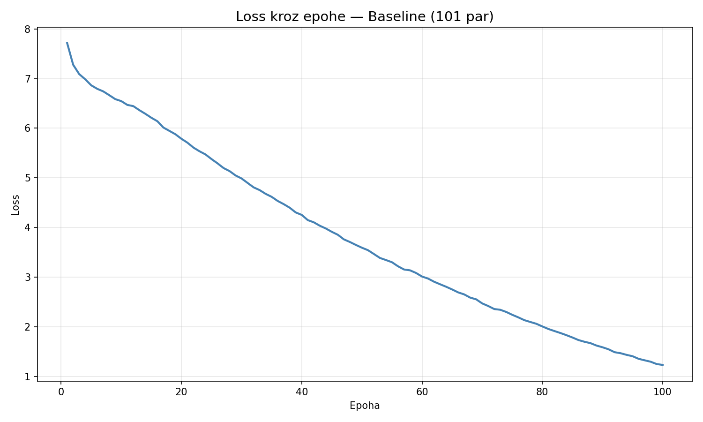
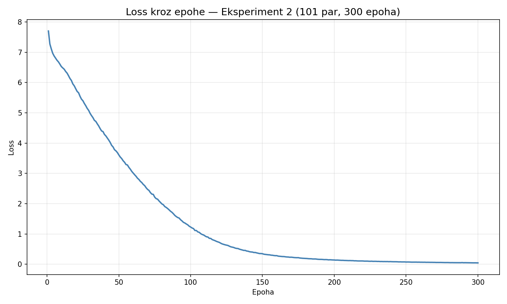

# Istraživački dnevnik — Stilski transfer teksta u duhu Ive Andrića

---

## 1. Uvod i cilj projekta

Cilj ovog projekta je istraživanje mogućnosti automatske transformacije
neutralnih, svakodnevnih rečenica na srpskom jeziku u rečenice koje stilski
podsećaju na prozu Ive Andrića — bogate epitetima, metaforama, filozofskim
tonom i karakteristično dugim, slojevitim rečenicama.

Model se trenira od nule, na sopstvenom, ručno kreiranom datasetu, bez
korišćenja gotovih, već istreniranih jezičkih modela. 

---

## 2. Arhitektura modela

Implementiran je **Encoder-Decoder Transformer od nule**, u PyTorch-u.
Svaka komponenta je posebna, samostalna celina u fajlu `src/model.py`, što
olakšava organizaciju, čitljivost i kasnije eventualne izmene. Komponente su:

- **MultiHeadAttention** — mehanizam pažnje sa 4 "glave" (`num_heads = 4`),
  implementiran ručno preko formule `softmax(QK^T / sqrt(d_k)) * V`. Svaka
  glava može da se fokusira na drugačiji tip veze između reči (npr. jedna na
  gramatičke odnose, druga na stilske obrasce).
- **PositionalEncoding** — sinusno/kosinusno kodiranje pozicije reči u
  rečenici, neophodno jer Transformer (za razliku od GRU/RNN modela) ne
  obrađuje rečenicu reč po reč, pa sam po sebi ne "zna" njihov redosled.
- **FeedForward** — dvoslojna mreža sa GELU aktivacijom (`d_ff = 1024`,
  4 puta veće od `d_model`), standardna praksa za moderne Transformer
  arhitekture.
- **EncoderLayer / DecoderLayer** — implementirani u **Pre-LN**
  konfiguraciji (normalizacija pre ulaska u attention/feedforward blok), što
  je stabilnije za treniranje na malim datasetima.
- **DecoderLayer** dodatno sadrži **cross-attention**, kojim dekoder "gleda"
  izlaz enkodera (originalnu neutralnu rečenicu) prilikom generisanja
  Andrićeve verzije.
- **Maskiranje** — `src_mask` ignoriše prazne (padding) tokene, a `tgt_mask`
  je takozvana kauzalna maska koja sprečava dekoder da "vidi" buduće tokove
  tokom treninga.

**Finalna konfiguracija modela:**

| Parametar     | Vrednost |
|---------------|----------|
| d_model       | 256      |
| num_heads     | 4        |
| d_ff          | 1024     |
| num_layers    | 3        |
| dropout       | 0.1      |
| Broj parametara | ~7.27M |

**Tokenizacija:** rečnik je izgrađen na nivou celih reči, direktno iz
dataseta, bez generičkog tokenizera (kakvi se koriste kod velikih modela tipa
GPT/BERT). Ovo je jednostavnije za implementaciju i razumevanje, ali ima
ograničenja — srpski jezik ima bogatu morfologiju (padeži, rodovi, glagolski
oblici), pa se mnoge reči u malom datasetu javljaju samo jednom ili dvaput, što
modelu teži učenje. Korišćenje generičkog tokenizera koji deli reči na manje,
ponovljive delove (tzv. subword tokenizacija) je realan pravac za poboljšanje
i razmatra se kao mogući budući eksperiment.

Specijalni tokeni: `[PAD]=0`, `[UNK]=1`, `[BOS]=2`, `[EOS]=3`.

**Trening:** funkcija greške `CrossEntropyLoss` (ignoriše PAD tokene),
optimizator **AdamW** (lr=0.0001, weight_decay=0.01), ograničavanje
gradijenta (gradient clipping, max_norm=1.0).

**Generisanje:** autoregresivno, token po token, sa **Top-K samplingom**
(k=50) i **temperaturom** (T=0.8), kako bi izlaz bio manje repetitivan i
manje rigidan u odnosu na uvek-najverovatniji izbor.

---

## 3. Dataset

- **Format:** CSV (`;` separator, UTF-8), kolone: `id`, `original_text`
  (Andrićeva rečenica), `neutral_text` (ručno napisana neutralna verzija).
- **Veličina:** dataset se postepeno skalira tokom projekta. Baseline
  verzija (Eksperiment 1) sadržala je **101 par rečenica**.

---

## Eksperiment 1 — Baseline trening (101 par, 100 epoha)

**Cilj eksperimenta:** Provjeriti da li ceo proces (dataset → model →
trening → generisanje) funkcioniše od početka do kraja, i dobiti prvu
referentnu vrednost funkcije greške (loss) za poređenje sa budućim
eksperimentima.

**Konfiguracija:** d_model=256, num_heads=4, d_ff=1024, num_layers=3,
dropout=0.1, batch_size=16, lr=0.0001, AdamW, 100 epoha, dataset: 101 par.

**Rezultati treninga (loss kroz epohe):**

| Epoha | Loss   |
|-------|--------|
| 10    | 6.5460 |
| 20    | 5.7871 |
| 30    | 4.9882 |
| 40    | 4.2545 |
| 50    | 3.5942 |
| 60    | 3.0134 |
| 70    | 2.4725 |
| 80    | 2.0086 |
| 90    | 1.5895 |
| 100   | 1.2341 |

**Zapažanje o krivoj greške:** Loss opada postepeno i bez naglih skokova ili
zastoja tokom svih 100 epoha. Pad je gotovo linearan u poslednjih 60-70
epoha, što sugeriše da model u trenutku prekida treninga **još uči** i nije
dostigao stagnaciju — odlučujuća informacija za Eksperiment 2 (produženi
trening).

**Generisanje — primeri:**

| Ulaz (neutralna rečenica)     | Izlaz modela |
|--------------------------------|--------------|
| Pada kiša na grad.             | "samo se nijema nikad u jednu boju i nadmoć u trenutku ima čestitih to nije od vrednosti smo da se upotpunjuju kao spomenik da se i naš bolje svršiti." |
| Čovek hoda ulicom.              | "tvoji prihodi je sposoban se, ga za obrađivanje i ne se često, društva u kotlovima nemir; živo stvorenje. mu je stvoreno, nezdrave kad smo će već između palca" |
| Sunce zalazi iza brda.           | "svašta je brujanje svoje svoj ni najtvrđem tome, i istakoše žuto, izbrazdano kad snaga to se mnogo svega onoga i nezdrav" |

**Analiza izlaza:**

- **Pozitivno:**
  - Model generiše isključivo postojeće srpske reči iz rečnika — nema
    izmišljenih reči.
  - Vokabular je tematski i stilski u duhu Andrića: "nijema", "nadmoć",
    "stvorenje", "izbrazdano", "spomenik" — reči koje se ne bi pojavile u
    neutralnom registru.
  - Interpunkcija (zarezi, tačka-zapeta, tačke) se javlja na mestima koja
    liče na granice celina u rečenici — model je delimično uhvatio ritam
    rečenice.
  - Model nije generisao identičnu kopiju nijedne rečenice iz dataseta —
    nema čistog "papagajskog" ponavljanja u ovoj fazi.

- **Negativno:**
  - Rečenice su gramatički i smisaono nekoherentne — nema jasnog subjekta,
    predikata, slaganja po rodu/broju/padežu na nivou cele rečenice.
  - Izlaz je delimično nezavisan od ulaza — sve tri ulazne rečenice (kiša,
    čovek, sunce) generišu tematski sličan, apstraktan "filozofski šum" bez
    jasne veze sa konkretnim sadržajem ulazne rečenice. Mehanizam pažnje
    između enkodera i dekodera (cross-attention) vrlo verovatno još nije
    naučio smislenu vezu između ulaza i izlaza.
  - Rečenice su predugačke i "lutaju" — nema jasnog zaključka, podsećaju na
    tok svesti bez strukture.

**Pretpostavka o uzroku:**

Najverovatniji uzrok nekoherentnosti je kombinacija dva faktora:
1. Mali dataset (101 par) za zadatak ove kompleksnosti — model nema dovoljno
   primera da nauči **mapiranje** neutralno→Andrić, već uglavnom uči opštu
   "statistiku" Andrićevog vokabulara i interpunkcije.
2. Nedovršen trening — kriva greške još opada, model nije stabilizovan.

Trenutno ne možemo razlikovati koliki je doprinos svakog faktora — to je
predmet narednih eksperimenata.

**Sledeći koraci:**
1. **Eksperiment 2:** Trenirati identičan model duže (npr. 300-500 epoha) na
   istom datasetu od 101 para, da se vidi: (a) da li greška nastavlja da
   opada, stagnira, ili model počinje da "pamti" dataset napamet
   (prekomerno prilagođavanje); (b) da li generisanje postaje koherentnije
   ili samo "samouverenije" u istim greškama.
2. **Eksperiment 3:** Proširiti dataset na oko 200 parova i ponoviti baseline
   trening (100 epoha) radi poređenja sa Eksperimentom 1 — razdvojiti efekat
   veličine dataseta od efekta dužine treninga.

---

## Eksperiment 2 — Produženi trening (101 par, 300 epoha)

**Cilj eksperimenta:** Isti model i isti dataset kao u Eksperimentu 1, ali sa
3x većim brojem epoha (300 umesto 100), kako bi se ispitalo da li greška
nastavlja da opada, da li dolazi do stagnacije, i kako produženo treniranje
utiče na kvalitet generisanog teksta.

**Konfiguracija:** identična kao u Eksperimentu 1, osim broja epoha
(300 umesto 100).

**Rezultati treninga (loss kroz epohe):**

| Epoha | Loss   |
|-------|--------|
| 100   | 1.2282 |
| 150   | 0.3470 |
| 200   | 0.1399 |
| 250   | 0.0724 |
| 300   | 0.0444 |

**Zapažanje o krivoj greške:** Za razliku od Eksperimenta 1, gde je pad
lossa bio gotovo linearan, ovde se vidi izrazito brz pad nakon epohe 100
(sa 1.23 na manje od 0.05 do epohe 300), nakon čega kriva počinje da se
ravna, ali ne dostiže potpunu stagnaciju do kraja treninga.

**Generisanje — primeri:**

| Ulaz (neutralna rečenica)     | Izlaz modela (skraćeno) |
|--------------------------------|--------------|
| Pada kiša na grad.             | svi su mi ljudi i te kako potrebni. svi, od one starice koja me je slast. ona daje i pri svemu tome često se svojoj lepoti, u stvari, ja samo ono što je dobro ni u nama iščezava a tek poneki vršak i stihijskom i prohteva. |
| Čovek hoda ulicom.              | dvaput u životu čovek je izložen jakom iskušenju da suviše govori o sebi. prvo je mladićko doba, sa njegovom bujnošću i nemirima svake vrste, a drugo staračko doba, sa manje ili više izrazitim i mrači kad ležu oblaci će ti najbolje kazati. |
| Sunce zalazi iza brda.           | jer, šta su sitne muke i odricanja koja hoda od mene. |

**Analiza izlaza:**

- **Pozitivno (na prvi pogled):**
  - Rečenice su gramatički znatno ispravnije nego u Eksperimentu 1 — postoji
    jasan subjekat, predikat, slaganje po rodu/broju/padežu.
  - Tekst zvuči "andrićevski" po tonu, ritmu i izboru reči.

- **Negativno — ključan nalaz:**
  - Provera nad datasetom je pokazala da veći delovi generisanog teksta
    (posebno odgovor za "Čovek hoda ulicom.") odgovaraju **direktno
    rečenicama iz dataseta**, koje su tokom 300 epoha naučene gotovo napamet.
  - Izlaz je i dalje slabo povezan sa konkretnim sadržajem ulazne rečenice —
    model ne "prevodi" ulaz, već **prepoznaje da treba da generiše
    "andrićevski" tekst** i onda reprodukuje deo neke od 101 poznatih
    rečenica koja mu je u tom trenutku najbliža po internoj reprezentaciji.

**Zaključak — kompromis između koherentnosti i originalnosti:**

Eksperimenti 1 i 2 pokazuju jasan **trade-off**:

- **Eksperiment 1** (loss ≈ 1.23): nekoherentan, ali tekst je "svež" — model
  kombinuje reči na nove načine, iako bez gramatičke ispravnosti.
- **Eksperiment 2** (loss ≈ 0.04): gramatički koherentan, ali ne zato što je
  model naučio **opšti stil** koji može primeniti na nov sadržaj, nego zato
  što je **prekomerno prilagođen (overfit)** na 101 primer i u velikoj meri
  reprodukuje viđene rečenice.

Veoma nizak loss (ispod ~0.1) na datasetu ove veličine je dakle **upozoravajući
signal**, ne poželjan ishod - što je važan nalaz za dalje eksperimente.

**Sledeći koraci:**
1. **Eksperiment 3:** Proširiti dataset (cilj: ~200 parova) — veći broj
   primera bi trebalo da smanji sposobnost modela da prosto "pamti" čitave
   rečenice, i da ga prisili da uči opštije obrasce.
2. Razmotriti **regularizaciju** (veći dropout, jači weight decay) i/ili
   **rano zaustavljanje treninga (early stopping)** na osnovu praćenja
   trenutka kada loss postane "previše nizak" u odnosu na veličinu dataseta.
3. Dugoročno: razmotriti subword tokenizaciju kao način da model generalizuje bolje sa ograničenom
   količinom podataka.

## Tehnički nalazi između eksperimenata — Early Stopping i SentencePiece tokenizacija

### Early Stopping

Early stopping je tehnika koja automatski zaustavlja trening kada model
prestane da napreduje — umesto da fiksno treniramo 100 ili 300 epoha,
model sam "odlučuje" kada je dovoljno. Implementacija je jednostavna:
pratimo funkciju greške kroz epohe i ako se ne poboljša određeni broj
uzastopnih epoha (tzv. patience), trening se prekida.

Međutim, early stopping ima smisla samo ako pratimo grešku na podacima
koje model **nije video tokom treninga** — tzv. validacioni skup. Ako
pratimo grešku samo na podacima kojima smo trenirali, model uvek može
da nastavi da "pamti" te iste primere, pa greška nastavlja polako da
opada sve do kraja treninga bez ikakvog zastoja. Tačno to se desilo u
našem slučaju: sa 101 parom rečenica, model nikad nije dostigao
stagnaciju jer je uvek mogao da bolje zapamti viđene primere.

Pravo rešenje bi bilo podeliti dataset na deo za trening (~80%) i deo
za validaciju (~20%) — ali sa 101 parom to bi značilo da model trenira
na svega ~80 primera, što bi dodatno pogoršalo već ograničene rezultate.
Stoga smo odlučili da early stopping ostavimo kao tehniku za kasniju
fazu, nakon proširivanja dataseta.

### SentencePiece tokenizacija sa Unigram algoritmom

Naš originalni tokenizer radi na nivou celih reči — svaka reč dobija
jedinstveni broj. To ima ozbiljan nedostatak za srpski jezik: "čovek",
"čoveka", "čoveku", "čoveče" su sve različiti tokeni, iako dele isti
koren i značenje. Model mora svaki oblik da nauči zasebno, što zahteva
puno primera.

SentencePiece je sofisticiraniji pristup koji deli reči na manje,
smislene delove — tzv. podreči. Na primer, "nesrećnom", "nesrećna" i
"nesrećnih" bi svi delili zajednički deo "nesreć", što modelu omogućava
da uči morfologiju jezika sa manje primera. Ovaj pristup koriste veliki
modeli poput LLaMA, T5 i Gemini, posebno za jezike sa bogatom
morfologijom kao što je srpski.

Pokušali smo da treniramo SentencePiece model sa Unigram algoritmom
na našem datasetu. Isprobali smo dve veličine rečnika:

- **vocab_size=500:** tokenizacija je bila previše gruba — reč "Pada"
  razlagana je na četiri zasebna tokena: `['▁', 'P', 'a', 'da']`,
  što je gore od word-level pristupa.
- **vocab_size=1000:** delimično poboljšanje, ali "Pada" je i dalje
  ostajalo razloženo na sitne delove umesto da bude jedan token.

Uzrok je jednostavan: da bi SentencePiece "naučio" da je "Pada" česta
i smislena celina, mora je videti dovoljno puta u korpusu. Sa svega
202 rečenice (101 par × 2 strane), većina reči se pojavljuje premalo
puta da bi algoritam mogao da proceni njihovu važnost. Rezultat su
tokeni na nivou karaktera ili slogova, umesto smislenih podreči.

Mogli smo pokušati da zaobiđemo ovaj problem na više načina (npr.
korišćenjem već istreniranog višejezičnog SentencePiece modela umesto
treniranja od nule), ali s obzirom da je proširivanje dataseta ionako
neophodan sledeći korak, odlučili smo da obe tehnike — early stopping
i SentencePiece — ostavimo za fazu nakon skaliranja. Tada će imati
pravi smisao i dati merljive rezultate.

**Zaključak:** oba tehnička poboljšanja koja smo pokušali ukazuju na
isti temeljni problem — nedovoljno podataka. Ovo dodatno potvrđuje
neophodnost Eksperimenta 3: proširivanje dataseta.